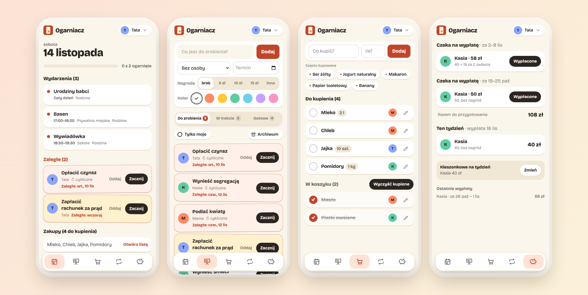
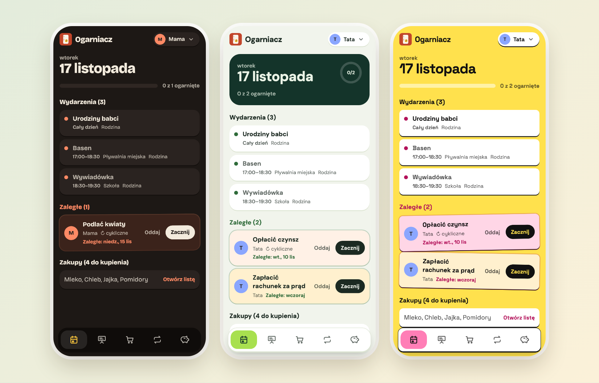

<div align="center">

# Ogarniacz

**Domowa aplikacja dla całej rodziny: zadania, zakupy i kalendarz w jednym miejscu.**<br>
Odpowiada na pytanie „co dziś mam ogarnąć?” i przypomina o tym powiadomieniem na telefonie.




<sub>Zrzuty z trybu demo (<code>npm run demo</code>), dane są przykładowe.</sub>

</div>

## Spis treści

- [Co potrafi](#co-potrafi)
- [Wygląd](#wygląd)
- [Szybki start](#szybki-start)
- [Stack i struktura](#stack-i-struktura)
- [Polecenia](#polecenia)
- [Konta i kopie zapasowe](#konta-i-kopie-zapasowe)
- [Konfiguracja](#konfiguracja)
- [Wdrożenie](#wdrożenie)
- [Dokumentacja](#dokumentacja)
- [Bezpieczeństwo](#bezpieczeństwo)

## Co potrafi

Prywatna aplikacja dla jednej rodziny, bez publicznej rejestracji. Działa jako PWA: instaluje się z przeglądarki na ekranie głównym iPhone'a i Androida, bez sklepów z aplikacjami.

| | Funkcja | Opis |
|---|---|---|
| 📅 | **Dziś** | Wydarzenia z kalendarzy, moje zadania na dziś i zaległe, pasek postępu dnia i skrót listy zakupów |
| 🗂️ | **Tablica** | Zadania w statusach „Do zrobienia”, „W trakcie” i „Gotowe”: osoba, termin, historia zmian, archiwum zamiast kasowania. Kartę można przeciągnąć na zakładkę statusu |
| 🔁 | **Zadania cykliczne** | Śmieci, kwiaty i inne obowiązki wracają same: co tydzień, co N dni albo co miesiąc, z pauzą na wakacje |
| 🛒 | **Zakupy** | Wspólna lista z podpowiedziami z historii. Działa **bez sieci**: zmiany czekają w kolejce na telefonie i same się synchronizują |
| 🗓️ | **Kalendarze** | Odczyt linków ICS z Google i iCloud (tylko do odczytu). Linki są szyfrowane w bazie |
| 🔔 | **Powiadomienia** | Web Push: poranne podsumowanie, przypomnienie o przypisanym zadaniu i o terminie jutro; godzina i cisza nocna do wyboru |
| 🐷 | **Kieszonkowe** | Stała kwota na tydzień i nagrody za wyróżnione zadania; dziecko widzi swoją kwotę, rodzic wszystkie |
| 👪 | **Rodzina i konta** | Rodzic zaprasza nową osobę linkiem albo kodem QR, wystawia link do nowego hasła, wyłącza konto dziecka i przegląda dziennik logowań. Każdy zmienia swoje hasło i wylogowuje inne urządzenia |
| 🔐 | **Role** | Rodzic i dziecko z uprawnieniami egzekwowanymi w API, nie tylko w interfejsie |

Pełną specyfikację ma [docs/PROJEKT.md](docs/PROJEKT.md), a stan prac [docs/PLAN.md](docs/PLAN.md).

## Wygląd

Trzy kierunki graficzne do wyboru w ustawieniach („Lodówka”, „Wieczorny las” i „Naklejki”), każdy w trybie jasnym i ciemnym. Kolor osoby jest widoczny dla całej rodziny, a wszystkie kolory interfejsu to nazwane zmienne w jednym miejscu.

<div align="center">

</div>

## Szybki start

Wymagany Node.js 22.12 lub nowszy, najlepiej 24 LTS.

### Zobacz z przykładowymi danymi

Bez zakładania kont i bez konfiguracji:

```bash
npm run demo
```

Skrypt instaluje zależności, jeśli trzeba, buduje aplikację, zakłada jednorazową bazę w katalogu tymczasowym, wgrywa przykładowe dane i uruchamia serwer na <http://localhost:3000>. Ctrl+C zatrzymuje go i usuwa dane demo; lokalna baza deweloperska nie jest ruszana.

| Konto | Rola | Hasło |
|---|---|---|
| `tata`, `mama` | rodzic | `demo-haslo` |
| `kasia` | dziecko | `demo-haslo` |

<details>
<summary>Opcje demo</summary>

- `PORT=3100 npm run demo` zmienia port, a `npm run demo -- --no-build` pomija build, gdy aplikacja jest już zbudowana.
- Daty w danych liczą się od dnia uruchomienia, więc zawsze są zaległe i dzisiejsze zadania.
- Wersja w Dockerze: `docker compose -f docker-compose.demo.yml up --build`.
- Dane można też wgrać ręcznie do **pustej** bazy poleceniem `demo seed`; do bazy z kontami odmówi.
- Tryb `DEMO_MODE` i jego zabezpieczenia: [docs/instrukcje/DEMO.md](docs/instrukcje/DEMO.md).

</details>

### Środowisko deweloperskie

```bash
npm install
npm run dev
```

Aplikacja działa na <http://localhost:5173>, a API na <http://localhost:3000>. Vite przekazuje do API wszystkie żądania `/api`. Baza powstaje sama przy pierwszym starcie API, w `apps/api/data`, a migracje uruchamiają się same.

Publicznej rejestracji nie ma. Na pustej bazie aplikacja zamiast logowania pokazuje kreator pierwszego uruchomienia: imię, login, hasło i kod, który API wypisuje w terminalu (`[start] pusta baza, kod pierwszego uruchomienia: …`). Kreator zakłada konto rodzica, a kolejne osoby rodzic zaprasza w ustawieniach, w sekcji „Rodzina”. Drogą zapasową jest CLI:

```bash
npm run cli -w @ogarniacz/api -- user add --login tata --name Tata --role parent
```

Przed pierwszym uruchomieniem testów e2e pobierz przeglądarki:

```bash
npx playwright install chromium webkit
```

## Stack i struktura

| Warstwa | Technologia |
|---|---|
| Front | React, Vite, TanStack Query, Tailwind, `vite-plugin-pwa` |
| Backend | Hono na Node.js, Zod, `node-cron`, `web-push` (powiadomienia), `ical.js` (kalendarze) |
| Baza | SQLite (`better-sqlite3`) i Drizzle |
| Testy | Vitest (API), Playwright (e2e na profilach telefonów) |
| Wdrożenie | Docker albo Node.js 24 za proxy z HTTPS; gałąź `prod` z wersjami, które przeszły CI |

```text
apps/api          # API, baza, harmonogram; w produkcji serwuje też front
apps/web          # PWA
packages/shared   # schematy Zod i typy wspólne dla frontu i API
e2e               # testy Playwright
docs              # dokumentacja
```

Schematy Zod z `packages/shared` są jedynym źródłem prawdy: API waliduje nimi wejście, a front parsuje nimi każdą odpowiedź. Architekturę, model danych i decyzje opisuje [docs/PROJEKT.md](docs/PROJEKT.md).

## Polecenia

| Komenda | Działanie |
|---|---|
| `npm run dev` | Front i API z automatycznym przeładowaniem |
| `npm run typecheck` | Sprawdzenie typów we wszystkich paczkach |
| `npm test` | Testy API (Vitest) na bazie w pamięci |
| `npm run test:e2e` | Testy Playwright na własnym serwerze (porty 5180 i 3080), więc można je uruchomić obok `npm run dev` |
| `npm run test:smoke` | Test dymny na zbudowanej aplikacji (po `npm run build`): service worker, start bez sieci, CSP i tryb demo |
| `npm run build` | Build frontu do `apps/api/public` i API do `apps/api/dist` |
| `npm start` | API z wbudowanym frontem, po `npm run build` |
| `npm run demo` | Demo z przykładowymi danymi na jednorazowej bazie |
| `npm run db:generate` | Nowa migracja po zmianie `apps/api/src/db/schema.ts` |
| `npm run vapid -w @ogarniacz/api` | Nowa para kluczy VAPID dla powiadomień push (opis w [docs/instrukcje/WDROZENIE.md](docs/instrukcje/WDROZENIE.md)) |
| `npm run cli -w @ogarniacz/api -- <polecenie>` | Konta, kopie zapasowe i kalendarze, opis niżej |
| `node scripts/screenshots.mjs [adres]` | Odświeża zrzuty ekranów w `docs/img` z uruchomionego demo (`npm run demo` w drugim terminalu) |

## Konta i kopie zapasowe

Na co dzień kontami zarządza rodzic w aplikacji (**Ustawienia → Rodzina**): zaproszenie nowej osoby, link do nowego hasła, wyłączenie konta dziecka, dziennik logowań. Link z zaproszenia jest jednorazowy i ważny 24 godziny, a hasło ustawia sama zapraszana osoba.

Pierwsze konto rodzica zakłada kreator pierwszego uruchomienia. Skrypt na serwerze jest drogą zapasową i awaryjną, np. gdy żaden rodzic nie ma dostępu (polecenie wywołuje się jak w sekcji [Środowisko deweloperskie](#środowisko-deweloperskie)):

| Polecenie | Działanie |
|---|---|
| `user list` | Lista kont |
| `user add --login <login> --name <imię> --role parent\|child` | Nowe konto, hasło wpisywane bez wyświetlania |
| `user passwd <login>` | Zmiana hasła, wylogowuje wszystkie urządzenia |
| `user disable <login>` / `user enable <login>` | Wyłączenie lub włączenie konta, także rodzica |
| `user log [--limit N]` | Dziennik logowań: próby, blokady, zmiany kont |
| `calendar list` | Kalendarze: serwis, ostatni udany odczyt i kod błędu (bez linków) |
| `calendar sync` | Wymusza synchronizację kalendarzy i wypisuje wynik |
| `demo seed` | Przykładowe konta i dane w pustej bazie (używa tego `npm run demo`) |
| `backup` / `backup list` | Kopia teraz albo lista kopii |
| `backup verify [plik]` | Próba odtworzenia kopii obok bazy, bez zatrzymywania serwera |
| `restore <plik> --yes` | Odtworzenie bazy z kopii; najpierw zatrzymaj serwer |

Na serwerze po buildzie te same polecenia daje `node dist/cli.cjs` w `apps/api`, a w Dockerze `docker compose exec ogarniacz node dist/cli.cjs`.

Kopia robi się sama co noc o 3:30 czasu polskiego, w katalogu `backups` obok bazy. Kopie starsze niż 14 dni są usuwane. Po ustawieniu `BACKUP_REMOTE` kopia trafia też, zaszyfrowana, na Google Drive. Konfigurację i odtwarzanie opisuje [docs/instrukcje/BACKUP.md](docs/instrukcje/BACKUP.md).

## Konfiguracja

Ustawienia API są opcjonalne. Opisuje je `apps/api/.env.example`, a lokalne wartości trafiają do `apps/api/.env`. Najważniejsze:

| Zmienna | Do czego |
|---|---|
| `DATABASE_PATH`, `PORT` | Położenie bazy i port API |
| `HOST` | Adres nasłuchu, domyślnie `127.0.0.1` (ruch z internetu przez proxy); w obrazie Docker `0.0.0.0` |
| `BACKUP_REMOTE` | Kopia poza serwerem przez rclone ([docs/instrukcje/BACKUP.md](docs/instrukcje/BACKUP.md)) |
| `CALENDAR_ENCRYPTION_KEY` | Klucz szyfrujący linki do kalendarzy; bez niego kalendarze są wyłączone |
| `VAPID_PUBLIC_KEY`, `VAPID_PRIVATE_KEY`, `VAPID_SUBJECT` | Klucze powiadomień push; bez kompletu powiadomienia są wyłączone |

## Wdrożenie

Aplikację da się uruchomić w Dockerze albo bezpośrednio na Node.js 24, na dowolnym serwerze z HTTPS i własną domeną albo subdomeną:

```bash
docker compose pull
docker compose up -d
```

Gotowy obraz (`ghcr.io/piekutlukasz/ogarniacz`, `amd64` i `arm64`) powstaje przy każdym wydaniu; `docker compose up -d --build` buduje go z repozytorium. Obraz jest też budowany i uruchamiany w CI przy każdej zmianie. Baza leży na wolumenie `ogarniacz-data`, a port 3000 jest dostępny tylko lokalnie, dla proxy z HTTPS. Gałąź `prod` wskazuje ostatni commit z `main`, który przeszedł całe CI:

```text
push na main ──► CI (audyt, typecheck, testy, build, e2e, test dymny, obraz Docker) ──► gałąź prod
```

Wymagania, przykład proxy, pierwsze konto, bezpieczną aktualizację (kopia, migracje na kopii, restart) i codzienną obsługę opisuje [docs/instrukcje/WDROZENIE.md](docs/instrukcje/WDROZENIE.md).

## Dokumentacja

Mapa całej dokumentacji: [docs/README.md](docs/README.md).

| Dokument | Zawartość |
|---|---|
| [Plan](docs/PLAN.md) | Etapy i stan prac hasłowo, z odnośnikami do szczegółowych planów w `docs/plany` |
| [Dokumentacja projektu](docs/PROJEKT.md) | Cel, funkcje, architektura, model danych, API, role, integracje i bezpieczeństwo |
| [Instrukcje](docs/README.md#instrukcje) | Wdrożenie, kopie zapasowe, kalendarze, demo |
| [Testy e2e](e2e/README.md) | Zasady pisania testów Playwright i page objecty |

## Bezpieczeństwo

Błąd bezpieczeństwa zgłoś prywatnie, według [SECURITY.md](SECURITY.md).

## Licencja

[MIT](LICENSE).
